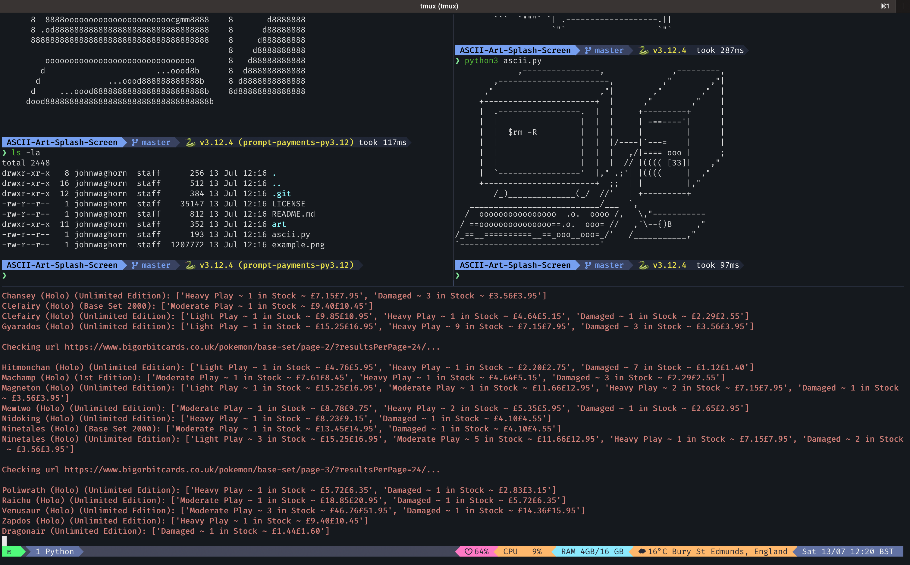

# configuration

Configurations for various tools and .dotfiles.

## Terminal setup

To setup your terminal, follow the steps below in order:

1. Install [zsh](zsh/README.md)
1. Install [Fira Code Nerd Font](fonts/README.md)
1. Install [Starship](starship/README.md)
1. Install [Oh My Zsh!](oh_my_zsh/README.md)
1. Install [tmux](tmux/README.md)

### Terminal look and feel

What this custom [tmux](tmux/README.md) configuration looks like when paired with the [Starship](starship/README.md) prompt:

