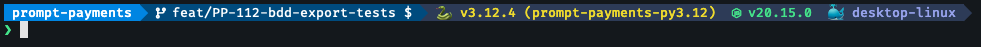

# Starship

Starship is a minimal, blazing-fast, and infinitely customizable prompt for
any shell! The prompt shows information you care about, while allowing you to
stay in your own workflow.

## Pre-requisites

- [Fira Code Nerd Font](../fonts/README.md).
- [zsh](../zsh/README.md)

## Installation

```shell
curl -fsSL https://starship.rs/install.sh | sh
```

>[!IMPORTANT]
> Ensure you follow the script instructions and add
> `eval "$(starship init zsh)"` to the end of your `~/.zshrc` file

## Configuration

To configure Starship copy the [starship.toml](starship.toml) file to
`~/.config/starship.toml`.

```shell
cp ./starship.toml ~/.config/starship.toml
```

## Look and feel

Here is what this custom prompt configuration looks like when you are in a
directory that utilises git, python, node and docker, after running a simple
`ls` command:


